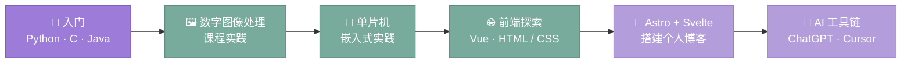

<!-- ============================================================
     LuvGaze · GitHub Profile
     ============================================================ -->

<!-- ══════════ 顶部渐变波浪头图 ══════════ -->
<div align="center">

<a href="https://github.com/LuvGaze">
  
</a>

<!-- 打字机标语（5 行中英轮播） -->
[](https://git.io/typing-svg)

<!-- 徽章墙 -->
[](https://github.com/LuvGaze)
[](https://github.com/LuvGaze?tab=followers)
[](https://github.com/LuvGaze/Blog/stargazers)
[](https://github.com/LuvGaze/Blog/network/members)
[](https://github.com/LuvGaze/Blog/commits)
[](https://LuvGaze.com)

</div>

> "时间如溪水般流过，但每一滴都映照着阳光"

---

## 👋 关于我

<div align="center">

### 你好，我是 LuvGaze°

一名热爱生活、探索音乐与艺术的爱好者 · 也喜欢把日子整理成 Markdown

</div>

> [!NOTE]
> ### 🌈 欢迎交流
> 如果你也热爱生活中的点滴美好，或是对艺术、科技、游戏有着独特的见解，欢迎随时与我分享你的想法和故事。
> 期待在这里遇见更多有趣的朋友，一起探索生活的无限可能！

---

## 🧰 技术栈 · 工具箱

<div align="center">


<br/><br/>


</div>

---

## 📊 GitHub 数据

<div align="center">

<a href="https://github.com/LuvGaze">
  
</a>
<a href="https://github.com/LuvGaze">
  
</a>

<br/>

<a href="https://github.com/LuvGaze">
  
</a>

<br/>

<h4>🗓️ 贡献日历 · 近一年</h4>

<a href="https://github.com/LuvGaze">
  
</a>

<br/>


</div>

---

## 🏆 成就与画像

<div align="center">
 
<!-- 里程碑徽章墙（替代已失效的奖杯服务） -->
[](https://github.com/LuvGaze/Blog/commits)
[](https://github.com/LuvGaze/Blog/graphs/contributors)
[](https://github.com/LuvGaze/Blog)
[](https://github.com/LuvGaze/Blog)
[](https://github.com/LuvGaze/Blog/blob/master/LICENSE)

<br/>

<a href="https://github.com/LuvGaze">
  
</a>

<br/>

<a href="https://github.com/LuvGaze">
  
</a>
<a href="https://github.com/LuvGaze">
  
</a>

</div>

---

## 🚀 我的仓库 · 项目

<div align="center">

<a href="https://github.com/LuvGaze/Blog">
  
</a>
<a href="https://github.com/LuvGaze/School">
  
</a>

</div>

### 📚 已开源项目

<details open>
<summary><strong>点击展开/收起</strong> ✨</summary>

| 项目 | 更新状态 | 简述 |
|------|---------|------|
| [**大学期间乱七八糟的文件**](https://github.com/LuvGaze/School/tree/其他) | 随缘更新 | 大学学习资料整理 |
| [**数字图像处理**](https://github.com/LuvGaze/School/tree/数字图像处理) | ~~结项~~ | 图像处理相关项目 |
| [**Python**](https://github.com/LuvGaze/School/tree/Python) | ~~结项~~ | Python学习记录 |
| [**单片机**](https://github.com/LuvGaze/School/tree/单片机) | ~~结项~~ | 单片机开发实践 |

</details>

> [!TIP]
> 我的主力项目是 **[LuvGaze/Blog](https://github.com/LuvGaze/Blog)** —— 一个 Astro 7 +
> Svelte 5 驱动的个人博客，文章、书架、影视、相册、足迹、账单、更新日志全部用 Markdown / YAML
> 托管，欢迎 Star ⭐ 或 Fork 折腾。

> [!WARNING]
> `School` 仓库是大学期间的**学习存档**，代码风格与完成度随缘，以参考为主，请谨慎用于生产环境。

---

## 🌟 推荐项目

<details open>
<summary><strong>点击展开/收起</strong> ✨</summary>

| 项目名称 | 描述 | 推荐指数 | 类别 |
|---------|------|----------|------|
| [**cursor-free-vip**](https://github.com/yeongpin/cursor-free-vip) | 自动重置机器ID，免费升级使用Cursor Pro功能 | ⭐⭐⭐⭐⭐ | 🛠️ 开发工具 |
| [**关圣云DNS去广告**](https://github.com/guandasheng/adguardhome) | TheBestAdrules，适用于Adguard Home的去广告dns规则 | ⭐⭐⭐⭐⭐⭐ | 🛡️ 网络工具 |
| [**RevokeMsgPatcher**](https://github.com/huiyadanli/RevokeMsgPatcher) | 适用于 Windows 下 PC 版微信/QQ/TIM的防撤回补丁 | ⭐⭐⭐⭐ | 💬 社交增强 |

> 💡 这些都是我个人使用过且觉得非常棒的项目，希望也能帮助到你！

</details>

---

## 📈 我的成长轨迹



---

## 👨‍💻 更多关于我

<details>
<summary><strong>点击展开/收起</strong> ✨</summary>

### 🎨 艺术创作

- 🎸 **吉他**：享受弹奏的过程，感受音乐的魅力(虽然还在路上)
- 🎤 **唱歌**： (室友有福了😅)

### 🔬 科技探索

- 🤖 **人工智能**：
  - ChatGPT、Cursor 等 AI 工具的探索者
- 💻 **编程技能**：

  ```text
  精通：
  ⬜⬜⬜ Python
  ⬜⬜ Java
  ⬜⬜ C语言

  学习中：
  ⬜ Vue.js
  ⬜⬜ HTML/CSS
  ```

### 📖 文艺生活

- 📚 热爱阅读，尤其是散文和科技文章
- ✍️ 喜欢写作，记录生活的点点滴滴

### 🎮 游戏世界

| 游戏 | 技能水平 |
|------|----------|
| [Minecraft](https://www.minecraft.net) | 🌟🌟🌟🌟🌟 |
| [英雄联盟](https://www.leagueoflegends.com) | 🌟🌟🌟🌟 |
| [QQ飞车](https://speedm.qq.com) | 🌟🌟🌟🌟🌟 |

### 🌈 生活技能

| 技能 | 描述 | 熟练度 |
|------|------|--------|
| 🍳 **美食探索** | • 热爱尝试各地美食<br>• 会做一些简单料理 | ★★★★★ |
| 🏃 **运动健身** | • 每周健身房打卡<br>• 保持健康生活方式 | ★★★★☆ |
| 📸 **摄影** | • 喜欢记录生活瞬间<br>• 风光摄影爱好者 | ★★★☆☆ |

### 🖥️ 编程技能

```text
Minecraft 游玩    [██████████] 90%
Java 基础         [░░░░░░░░░░] 00%
Python 应用       [░░░░░░░░░░] 00%
Web 前端          [░░░░░░░░░░] 00%
```

</details>

---

## 📫 联系方式

> 如果你想了解更多，欢迎通过以下方式找到我：

<div align="center">

[](mailto:Bnz277@outlook.com)
[](https://github.com/LuvGaze)
[](https://user.qzone.qq.com/2773434682)
[](https://space.bilibili.com/473335461)

</div>

---

## ⭐ Star History

<div align="center">

[](https://star-history.com/#LuvGaze/Blog&Date)

</div>

---

<!-- ══════════ 底部致谢 ══════════ -->
<div align="center">

### ✨ 感谢您的驻足

> 感谢您走进这片小小的天地，愿这里的每一行字都能如冬日暖阳般给您带来温暖与灵感，
> 在忙碌的生活里找到片刻宁静与共鸣！

[](https://git.io/typing-svg)


</div>


